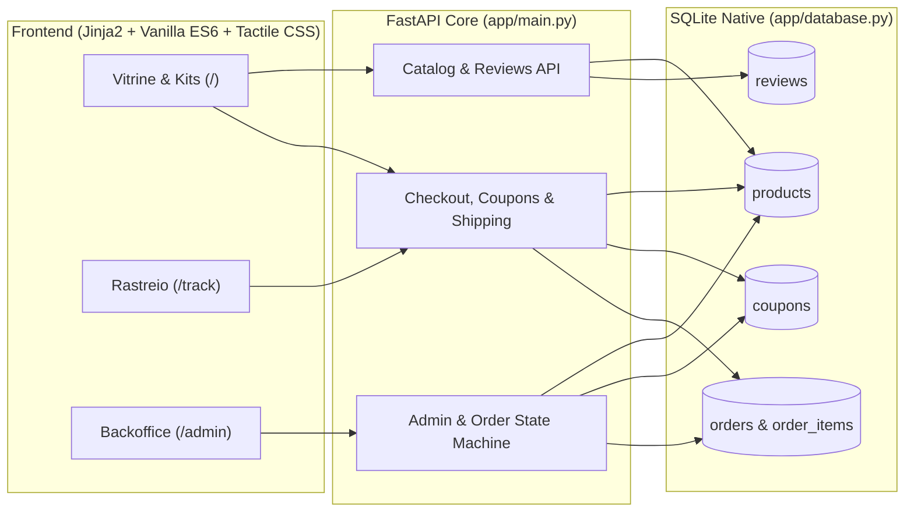

# NovaStore Engine v3.0 — High-Performance Dev Gear E-Commerce

Plataforma completa de e-commerce **End-to-End** para hardware de engenharia de software, construida com **FastAPI**, **SQLite relacional nativo**, validacao estrita via **Pydantic** e interface autoral sob a arquitetura **Tactile Soft-Neumorphic & Editorial Teal (Dark/Light)**.

---

## Destaques de Engenharia

- **Design System Proprio (Zero Frameworks CSS/JS)**:
  - Arquitetura **Tactile Soft-Neumorphic** com sistema de tripla sombra direcional (`--shadow-raise`, `--shadow-soft`, `--shadow-press`), substituindo bordas convencionais por relevo fisico esculpido.
  - **Modo Escuro Abissal por Padrao** (`#071417` / `#0E252B` / `#3DB663` / `#E5BA97`) com alternancia instantanea para Modo Claro (`html[data-theme="light"]`) persistida em `localStorage`.
  - Fundo arquitetonico em 4 camadas: malha CAD + matriz de micro-pontos (`body::before`), auroras difusas reativas ao cursor (`--page-mx`, `--page-my`), orbes neumorficos flutuantes (`.bg-stage`) e textura organica film-grain (`feTurbulence`).
- **Motor de Checkout, Frete & Promocoes**:
  - Cotacao dinamica de frete por faixa regional de CEP (`POST /api/shipping/quote`) com isencao automatica acima de R$ 500,00.
  - Motor de cupons promocionais (`DEV10`, `SIDI20`, `FRETEGRATIS`) acumulavel com desconto de **5% via PIX** calculado sobre o subtotal liquido.
  - Controle transacional de estoque com bloqueio imediato contra overselling.
- **Rastreamento Logistico & Historico (`/track`)**:
  - Busca unificada por codigo de rastreio (`ORD-XXXXXXXX`) ou e-mail do comprador (`GET /api/orders/search`).
  - Timeline visual de 4 estagios (`Confirmado` -> `Em Separacao` -> `Enviado` -> `Entregue` / `Cancelado`).
- **Backoffice Executivo (`/admin`)**:
  - Dashboard de KPIs em tempo real (Receita Liquida, Ticket Medio, Total de Pedidos e Alertas de Estoque Critico).
  - CRUD completo de produtos, edicao rapida de preco/estoque e gerenciador de cupons.
  - **Maquina de Estados com Estorno Automatico**: Ao alterar o status de um pedido para `Cancelado`, o backend restaura automaticamente as quantidades de cada SKU no banco de dados; caso o pedido seja reaberto, o saldo e deduzido novamente de forma atomica.

---

## Arquitetura do Sistema



---

## Estrutura do Projeto

```text
store_app/
├── app/
│   ├── main.py              # Rotas HTML, endpoints REST e maquina de estados de pedidos
│   ├── models.py            # Schemas Pydantic com validacao estrita de dominio
│   ├── database.py          # Camada SQLite, migracoes automaticas e seed de dados
│   ├── static/
│   │   ├── style.css        # Design System Tactile Soft-Neumorphic (Dark & Light)
│   │   ├── app.js           # Estado reativo, carrinho, checkout, reviews e spotlights
│   │   └── images/          # Ativos fotograficos de estudio dos produtos
│   └── templates/
│       ├── index.html       # Vitrine principal, bundles interativos e modais
│       ├── track.html       # Portal de rastreamento e linha do tempo de entrega
│       ├── admin.html       # Painel executivo de operacoes, estoque e cupons
│       └── order_success.html # Recibo tecnico pos-compra
├── tests/
│   └── test_novastore.py    # Suite de testes de integracao E2E (unittest + TestClient)
├── pyproject.toml           # Dependencias e metadados gerenciados via uv
└── run.py                   # Entrypoint ASGI (Uvicorn)
```

---

## Endpoints Principais da API

| Metodo | Rota | Descricao |
| :--- | :--- | :--- |
| `GET` | `/api/products` | Lista catalogo com suporte a filtro (`category`) e ordenacao (`sort`) |
| `GET` | `/api/products/{id}` | Retorna detalhes tecnicos, estoque e nota media do produto |
| `GET/POST` | `/api/products/{id}/reviews` | Lista e publica avaliacoes verificadas de clientes |
| `POST` | `/api/coupons/validate` | Valida cupom promocional e calcula desconto sobre o subtotal |
| `POST` | `/api/shipping/quote` | Calcula custo, prazo e regiao de entrega por CEP |
| `POST` | `/api/checkout` | Processa pedido com baixa transacional de estoque |
| `GET` | `/api/orders/search?q=` | Busca pedidos por codigo `ORD-...` ou e-mail do cliente |
| `GET` | `/api/admin/metrics` | Retorna KPIs financeiros e operacionais em tempo real |
| `PATCH` | `/api/admin/orders/{id}/status` | Atualiza status do pedido com estorno/re-deducao automatica de estoque |
| `POST/PUT/DELETE` | `/api/admin/products` | Criacao, atualizacao rapida e remocao de produtos |
| `POST` | `/api/admin/coupons` | Cria ou atualiza cupons promocionais (`upsert`) |

---

## Como Executar Localmente

### Pre-requisitos
- **Python 3.12+**
- **[uv](https://docs.astral.sh/uv/)** (gerenciador de pacotes e ambientes Python)

### 1. Iniciar o Servidor de Desenvolvimento
```powershell
uv run python run.py
```

Acesse no navegador:
- **Vitrine Principal**: `http://127.0.0.1:8000`
- **Rastreamento de Pedidos**: `http://127.0.0.1:8000/track`
- **Backoffice Executivo**: `http://127.0.0.1:8000/admin`
- **Swagger / OpenAPI Docs**: `http://127.0.0.1:8000/docs`

### 2. Executar a Suite de Testes E2E
```powershell
uv run python -m unittest discover -s tests -v
```

---

## Autor

Desenvolvido por **Guilherme Gustavo Weber** — Indaiatuba, SP.
